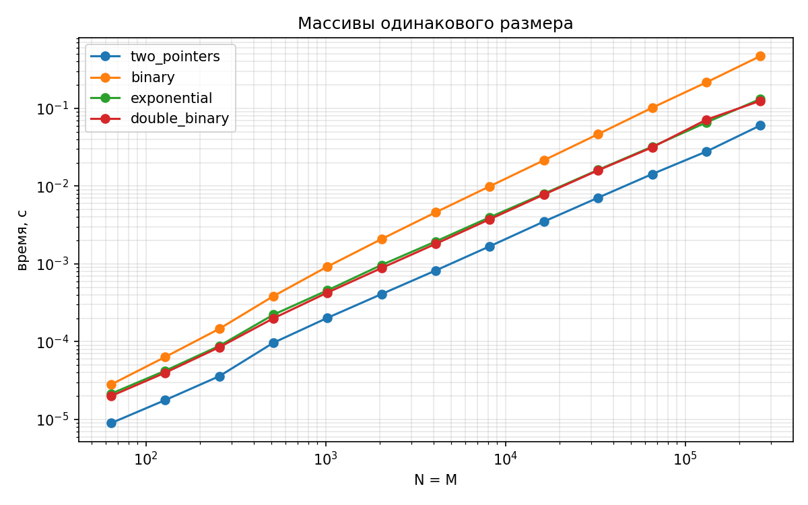
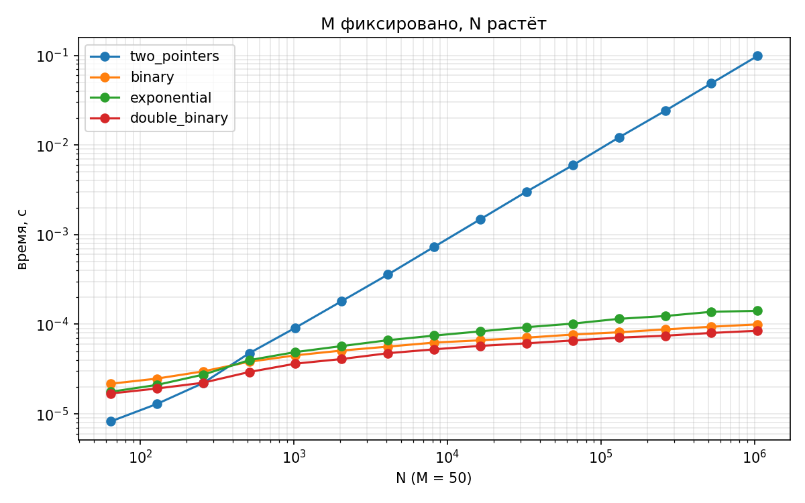
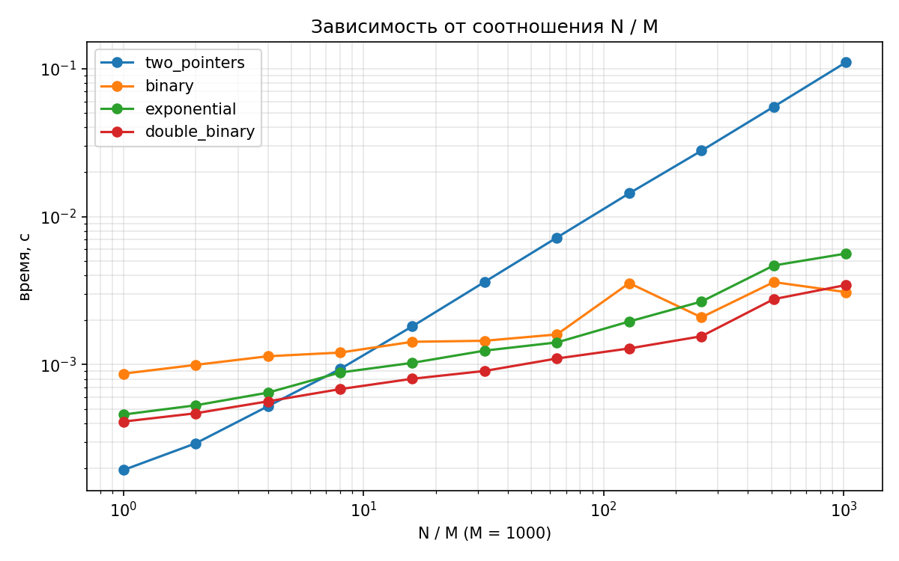

# Лабораторная работа 1. Общий элемент в двух отсортированных массивах

## Задача

Даны два отсортированных массива целых чисел длины M и N. Нужно вернуть `True`, если в них есть
хотя бы один общий элемент, иначе `False`. Я реализовала четыре разных решения этой задачи и выяснила,
при каких размерах массивов какой алгоритм работает быстрее.

Примеры из задания:
- `[1,2,3], [3,4,5]` -> `True`
- `[2,4,6], [3,5,7]` -> `False`
- `[], []` -> `False`

## Мои алгоритмы (папка `algorithms/`)

| Алгоритм | Файл | Время | Память |
|---|---|---|---|
| Два указателя | `two_pointers.py` | O(M+N) | O(1) |
| Бинарный поиск | `binary.py` | O(M log N) | O(1) |
| Экспоненциальный | `exponential.py` | O(M log(2N/M)) | O(1) |
| Бинарный с разделением | `double_binary.py` | O(M log(2N/M)) | O(log M) |

В тех алгоритмах, где это нужно, массивы меняются местами так, чтобы `a` был короче `b` (M <= N).

## Структура проекта

- `algorithms/` - мои четыре алгоритма
- `tests/test_algorithms.py` - тесты, которые я написала для проверки корректности
- `generate.py` - генерация тестовых данных для замеров
- `benchmark.py` - замеры времени, результат в `data/results.csv`
- `plot.py` - построение графиков в `plots/`
- `main.py` - запускает тесты, замеры и графики подряд

## Запуск

    pip install -r requirements.txt
    python main.py

(или `pip install matplotlib` вместо первой команды)

Только тесты:

    python -m unittest discover tests

## Как я проверяла корректность

- Примеры из задания: `[1,2,3],[3,4,5]` -> True; `[2,4,6],[3,5,7]` -> False; `[],[]` -> False.
- Крайние случаи: один массив пустой, по одному элементу, совпадение в начале, в середине и в конце,
  повторяющиеся числа, отрицательные числа, чётные против нечётных, огромные числа (порядка 10^18 и 10^30),
  когда первый массив длиннее второго.
- Случайные тесты: я прогнала тысячи пар случайных отсортированных массивов (малые и большие значения,
  сильно разные длины, крупные массивы на 1000 и 100 000 элементов). Ответ каждого алгоритма
  я сравнивала с эталоном `len(set(a) & set(b)) > 0`.
- Отдельный тест проверяет, что алгоритмы не изменяют входные массивы.

## Как я готовила данные для замеров

Я взяла худший случай, когда общих элементов нет и алгоритм не может завершиться раньше:
в массив B записала чётные числа `0, 2, 4, ...`, в массив A — нечётные числа, равномерно
распределённые по диапазону B (как и рекомендовано в задании). Замер — `time.perf_counter()`,
каждый замер я повторяла 5 раз и брала минимум: он меньше всего зависит от посторонней
нагрузки на компьютер. Оси на графиках логарифмические.

Три серии замеров:
1. M = N, размер от 64 до 262 144.
2. M = 50 фиксировано, N растёт от 64 до 1 048 576.
3. M = 1000 фиксировано, отношение N/M от 1 до 1024.

## Результаты и выводы

Сырые данные: [`data/results.csv`](data/results.csv).

### 1. Массивы одинакового размера (M = N)

Быстрее всех — два указателя (для N = 262 144 около 0,06 с). Алгоритмы с бинарным поиском
оказываются в 2-8 раз медленнее, а обычный бинарный поиск — самый медленный (около 0,47 с):
он делает N полных поисков по массиву длины N.

### 2. M = 50 фиксировано, N растёт

Когда N растёт, два указателя проигрывают: их время растёт линейно вместе с N (около 0,1 с
при N = 10^6), в то время как три остальных алгоритма почти не растут (около 0,0001 с) —
они пропускают большие куски массива B целиком и быстрее примерно в 1000 раз.

### 3. Зависимость от отношения N / M (M = 1000)

Кривые на графике пересекаются:
- до N/M примерно 4 быстрее два указателя;
- начиная примерно с N/M = 8 выигрывают алгоритмы с бинарным поиском, и разрыв растёт с отношением.

Среди самих бинарных двойной бинарный и экспоненциальный почти одинаковы по времени.
Экспоненциальный лучше обычного бинарного при небольшом N/M: он ищет на коротких отрезках.
При очень большом N/M обычный бинарный поиск становится не хуже экспоненциального —
у экспоненциального больше действий на каждый элемент.

## Итоговые выводы

- Пока размеры массивов близки, быстрее всех два указателя.
- Когда размеры сильно различаются, выигрывают бинарный поиск с разделением или экспоненциальный.
- По памяти: у двойного бинарного поиска O(log M) из-за рекурсии, у остальных O(1).
